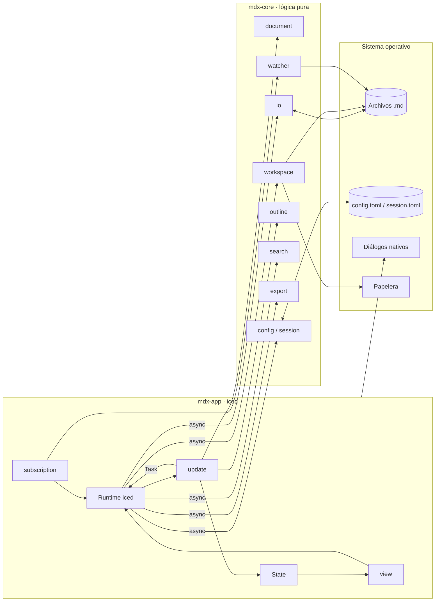
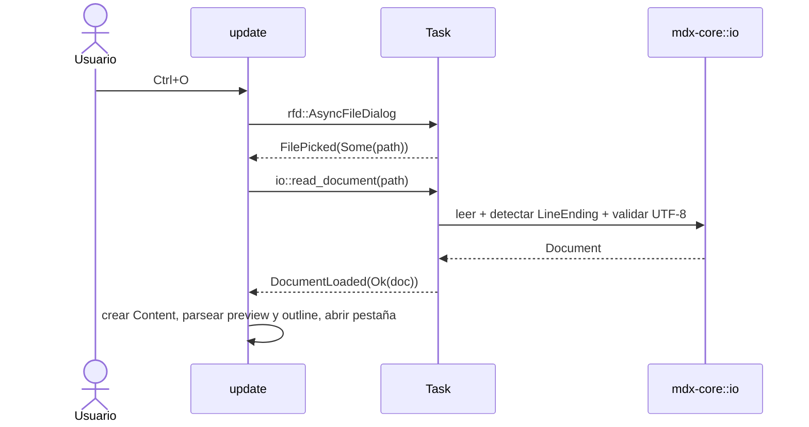

# ARCHITECTURE.md — Arquitectura de Mdx

> Describe cómo está construido Mdx y por qué. Tipos y formatos: `docs/DATA.md`. Librerías y versiones: `docs/STACK.md`.
> Toda decisión que cambie este documento requiere un ADR en `docs/adr/`.

---

## 1. Vista general



## 2. Capas y responsabilidades

| Capa | Crate | Responsabilidad | Depende de |
|---|---|---|---|
| Presentación | `mdx-app` | Ventana, widgets, atajos, temas, orquestación de `Task`s | `iced`, `rfd`, `mdx-core` |
| Dominio + infraestructura | `mdx-core` | Documentos, I/O atómico, árbol, watcher, outline, búsqueda, exportación, config, sesión | `pulldown-cmark`, `comrak`, `ignore`, `notify`, `trash`, `serde`, `toml` |
| Herramientas | `xtask` | Generar fixtures, medir tamaño del binario, tareas de release | `mdx-core` (opcional) |

**Regla de dependencia:** `mdx-app → mdx-core`. Nunca al revés. `mdx-core` no conoce `iced`.

## 3. Módulos de `mdx-core`

| Módulo | Expone | Notas |
|---|---|---|
| `document` | `Document`, `LineEnding`, `DiskState`, `DocumentId` | Puro, sin I/O |
| `io` | `read_document(path)`, `write_atomic(path, bytes)` | Async (`tokio::fs`); temp en mismo dir + `rename` + `fsync` |
| `workspace` | `Workspace`, `FileNode`, `load_children(dir, filters)`, operaciones (crear, renombrar, papelera) | Usa `ignore::WalkBuilder` con `max_depth(1)` para carga perezosa |
| `watcher` | `watch(root) -> impl Stream<Item = FsEvent>` | `notify-debouncer-full`, 200 ms; filtra por `TreeFilters` |
| `outline` | `extract(text) -> Outline` | `pulldown-cmark` con `into_offset_iter` para obtener la línea |
| `search` | `search_text(text, q)`, `search_workspace(root, q, cancel) -> Stream<SearchMatch>` | `regex`; cancelación con `CancellationToken` o `AtomicBool` |
| `export` | `to_html(text, theme) -> String` | `comrak` con GFM; CSS embebido |
| `config` | `Config`, `load()`, `save()`, migraciones | `serde` + `toml`; valida y acota |
| `session` | `Session`, `load()`, `save()` | Igual que config |
| `error` | `CoreError` | `thiserror`, `Clone` |

## 4. Estructura de `mdx-app`

```
mdx-app/src/
├── main.rs          # init de tracing, parseo CLI, arranque iced
├── app.rs           # State, Message, update, view, subscription (orquestador)
├── layout.rs        # disposición del pane_grid (20/40/40), lógica pura
├── state/
│   ├── tabs.rs      # lógica pura de pestañas (testeable)
│   └── editors.rs   # HashMap<DocumentId, text_editor::Content>
├── views/
│   ├── explorer.rs  ├── tabs.rs     ├── editor.rs
│   ├── preview.rs   ├── outline.rs  ├── search.rs
│   ├── statusbar.rs └── banner.rs   # conflictos, errores, avisos
├── widgets/         # widgets propios si iced no alcanza (requiere ADR)
├── shortcuts.rs     # mapeo tecla → ShortcutAction por plataforma
├── theme.rs
└── strings.rs       # textos de UI (español)
```

`app.rs` delega: cada `Message` de un área se maneja en una función `handle_<área>` para evitar un `match` monolítico.

## 5. Patrón de ejecución (arquitectura Elm)

```
Evento (teclado, mouse, FsEvent, timer)
      │
      ▼
 Message ──► update(&mut State, Message) ──► Task<Message> (async: I/O, búsqueda, export)
                    │                                │
                    ▼                                ▼
               State mutado                 Message de resultado ──► update ...
                    │
                    ▼
             view(&State) ──► árbol de widgets ──► render (wgpu / tiny-skia)
```

**Reglas:**
1. `update` es síncrono y rápido (< 1 ms típico). Todo lo que toca disco o recorre colecciones grandes va en `Task::perform`.
2. `view` es pura: no muta estado, no hace I/O, no parsea Markdown (usa los `markdown::Item` ya parseados en `State`).
3. `subscription` declara: watcher del workspace activo, timer de debounce de preview (solo si hay cambios pendientes), timer de autoguardado (solo si está activo), eventos de teclado y de cierre de ventana.

## 6. Flujos clave

### 6.1 Abrir archivo



### 6.2 Guardar

1. `Save(id)` → si `path == None` → `SaveAs`.
2. `Task`: aplicar `line_ending` → `io::write_atomic`.
3. `Saved(id, Ok(info))` → actualizar `saved_hash`, `disk_mtime`, título de ventana.
4. Error → banner con mensaje de `CoreError`; el documento sigue dirty.

### 6.3 Edición y preview

1. `Edit(id, action)` → `content.perform(action)`; si es edición, marcar `preview_pending = true` y guardar `last_edit = Instant::now()`.
2. `subscription` emite `PreviewTick` cada 50 ms solo mientras `preview_pending`.
3. En `PreviewTick`, si `now - last_edit ≥ 150 ms` → re-parsear (incremental cuando sea posible) preview y outline; `preview_pending = false`.

### 6.4 Cambio externo

Ver `docs/DATA.md` §3.2.

## 7. Concurrencia

- Runtime async: **tokio** (feature de iced).
- Sin hilos manuales ni `Mutex` compartidos con la UI. La comunicación es solo por `Message`.
- Operaciones largas (búsqueda en workspace) son cancelables: el `State` guarda un token; un nuevo `SearchWorkspace` cancela el anterior.
- El watcher corre en su propio hilo (interno de `notify`) y se expone como `Stream` a una `Subscription`.

## 8. Manejo de errores

| Origen | Tratamiento |
|---|---|
| `mdx-core` | `Result<T, CoreError>`; nunca panic por input externo |
| Bordes de `mdx-app` (`main`) | `anyhow` para fallas de arranque |
| Errores de operación del usuario | Banner/toast no bloqueante con texto de `strings.rs` |
| Errores inesperados | `tracing::error!` + banner genérico; la app sigue viva |
| Panic | `std::panic::set_hook` escribe log en el dir de estado; en debug, panic normal |

## 9. Rendimiento por diseño

| Técnica | Dónde |
|---|---|
| Carga perezosa del árbol | `workspace::load_children` por directorio |
| Debounce | preview/outline 150 ms, watcher 200 ms, autoguardado 2 s |
| Parseo incremental | widget `markdown` de iced |
| Re-render reactivo | iced 0.14 redibuja solo cuando hay cambios |
| Features mínimas | `default-features = false` donde se pueda (ver STACK.md) |
| Perfil release | `lto = "fat"`, `codegen-units = 1`, `strip = true`, `opt-level = 3`, `panic = "abort"` |

## 10. Estrategia de pruebas

| Nivel | Qué | Herramienta |
|---|---|---|
| Unitario | Cada módulo de `mdx-core`; lógica pura de `state/` en `mdx-app` | `cargo test` |
| Integración | Flujos de disco reales en tempdir (abrir/guardar/watcher/árbol) | `crates/mdx-core/tests/`, `tempfile` |
| Snapshot | Outline, exportación HTML, serialización de config/sesión | `insta` |
| Rendimiento | Árbol de 10 000 archivos, fixture de 5 MB | tests `#[ignore]` + `cargo test -- --ignored` |
| Manual UI | AC visuales por fase | `docs/CHECKLIST.md` |

## 11. Seguridad y datos del usuario

- Guardado atómico siempre; borrado solo a papelera.
- La preview **no** ejecuta HTML ni scripts: el widget `markdown` de iced no interpreta HTML crudo. La exportación HTML con `comrak` usa el modo seguro (sin `unsafe_`), que escapa el HTML crudo.
- Enlaces externos se abren con el navegador del sistema solo tras clic explícito; solo esquemas `http`, `https` y `mailto`.
- Imágenes de la preview: solo rutas locales relativas al documento en v1 (sin red).

## 12. Registro de decisiones (ADR)

Formato `docs/adr/NNNN-titulo-en-kebab.md`: **Contexto / Decisión / Alternativas / Consecuencias / Estado**.

| ADR | Título | Estado |
|---|---|---|
| 0001 | iced 0.14 como framework de UI | Aceptado |
| 0002 | Separación `mdx-core` / `mdx-app` | Aceptado |
| 0003 | pulldown-cmark para preview, comrak para exportación | Aceptado |
| 0004 | Persistencia en TOML sin base de datos | Aceptado |
