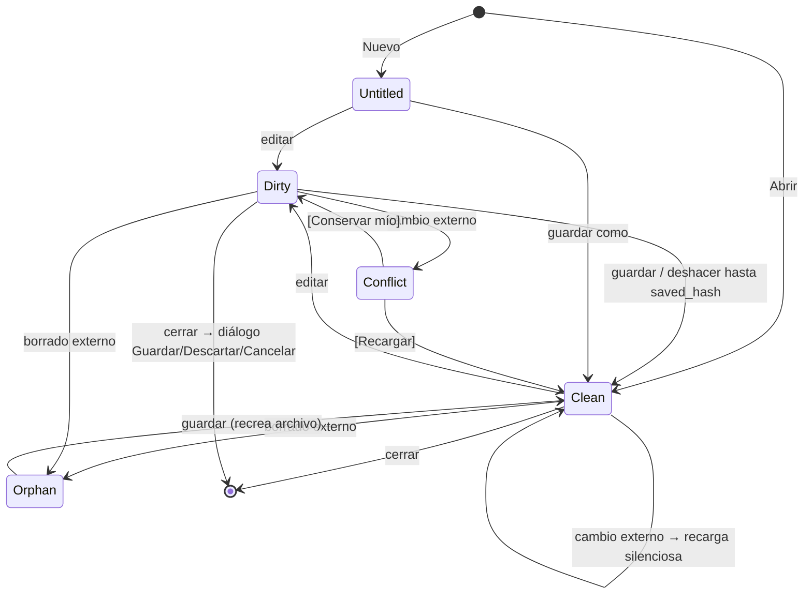

# DATA.md — Modelo de datos de Mdx

> Fuente de verdad de los tipos, estados, archivos persistidos e invariantes.
> Complementa `docs/PRD.md` y `docs/ARCHITECTURE.md`. Si cambias un tipo aquí descrito, actualiza este documento en el mismo commit.

---

## 1. Principios

1. **El disco es la verdad** para el contenido guardado; el estado en memoria es la verdad para el contenido no guardado.
2. **Mdx no tiene base de datos.** Solo persiste: archivos del usuario (`.md`), `config.toml` y `session.toml`.
3. Todo tipo de dominio vive en `mdx-core` y es `Clone + Debug`. Los tipos persistidos además son `Serialize + Deserialize`.
4. Ningún tipo de `mdx-core` referencia tipos de `iced`.

---

## 2. Tipos de dominio (`mdx-core`)

### 2.1 Identificadores

```rust
/// Identificador estable de un documento abierto durante la vida del proceso.
#[derive(Clone, Copy, Debug, PartialEq, Eq, Hash, PartialOrd, Ord)]
pub struct DocumentId(u64);   // generado por un contador atómico; no se persiste
```

### 2.2 Document

```rust
pub struct Document {
    pub id: DocumentId,
    pub path: Option<PathBuf>,      // None = "Sin título"
    pub text: String,               // contenido en memoria, normalizado a '\n'
    pub line_ending: LineEnding,    // detectado al abrir; se re-aplica al guardar
    pub has_bom: bool,              // el original traía BOM UTF-8; se re-escribe al guardar
    pub saved_hash: Option<u64>,    // hash (xxh3) del texto normalizado tal como está en disco
    pub disk_mtime: Option<SystemTime>,
    pub disk_state: DiskState,
}

#[derive(Clone, Copy, Debug, PartialEq, Eq, Serialize, Deserialize)]
pub enum LineEnding { Lf, CrLf }

#[derive(Clone, Copy, Debug, PartialEq, Eq)]
pub enum DiskState {
    InSync,             // disco == saved_hash
    ChangedExternally,  // disco cambió y el doc tiene cambios locales → banner
    Deleted,            // el archivo ya no existe en disco
}
```

**Reglas:**
- `is_dirty() == (hash(text) != saved_hash)`; un documento sin ruta y vacío **no** es dirty.
- Al abrir: se detecta `LineEnding` (si hay ≥ 1 `\r\n` → `CrLf`), se normaliza `text` a `\n`.
- Al guardar: se convierte `\n` → `line_ending`, se escribe atómico, se actualiza `saved_hash` y `disk_mtime`.
- Codificación: solo UTF-8 en v1. BOM UTF-8 se acepta y se preserva (campo `has_bom`).

### 2.2.1 Historial de edición

```rust
pub type Pos = (usize, usize);   // (línea, columna en bytes), base 0
pub struct History { /* pila de cambios por diferencias; ≤ 8 MB */ }
pub struct Patch { pub start: usize, pub end: usize, pub replacement: String, pub cursor: Pos }
```
Vive por documento abierto; se vacía al abrir/crear. No se persiste.

### 2.3 Workspace y árbol de archivos

```rust
pub struct Workspace {
    pub root: PathBuf,              // canónica
    pub tree: FileNode,
    pub filters: TreeFilters,
}

pub struct TreeFilters {
    pub respect_gitignore: bool,    // default: true
    pub show_hidden: bool,          // default: false
    pub only_markdown: bool,        // default: true
}

pub struct FileNode {
    pub path: PathBuf,
    pub name: String,
    pub kind: NodeKind,
}

pub enum NodeKind {
    File { is_markdown: bool },
    Dir  { children: Children, expanded: bool },
}

pub enum Children {
    NotLoaded,                      // carga perezosa
    Loading,
    Loaded(Vec<FileNode>),          // ordenados: dirs primero, luego alfabético case-insensitive
    Error(String),
}
```

Extensiones Markdown: `md`, `markdown`, `mdown`, `mkd` (case-insensitive).

### 2.4 Eventos del sistema de archivos

```rust
pub enum FsEvent {
    Created(PathBuf),
    Modified(PathBuf),
    Removed(PathBuf),
    Renamed { from: PathBuf, to: PathBuf },
}
```

### 2.5 Outline

```rust
pub struct Heading {
    pub level: u8,         // 1..=6
    pub text: String,      // texto plano, sin marcado inline
    pub line: usize,       // 0-based, línea de origen en el documento
}
pub type Outline = Vec<Heading>;
```

### 2.6 Búsqueda

```rust
pub struct SearchQuery {
    pub pattern: String,
    pub case_sensitive: bool,
    pub whole_word: bool,
    pub regex: bool,
}

pub struct SearchMatch {
    pub path: PathBuf,
    pub line: usize,          // 0-based
    pub col_range: Range<usize>, // en bytes dentro de la línea
    pub preview: String,      // línea recortada a 200 chars
}
```

### 2.7 Pestañas (estado de UI, vive en `mdx-app`)

```rust
pub struct Tab {
    pub doc: DocumentId,
    pub pinned: bool,         // false = pestaña "preview" reutilizable (clic simple)
}

pub struct Tabs {
    pub items: Vec<Tab>,
    pub active: Option<usize>,
}
```

Invariante: como máximo **una** pestaña con `pinned == false`.

---

## 3. Máquinas de estado

### 3.1 Ciclo de vida de un documento



`Conflict` = `DiskState::ChangedExternally`; `Orphan` = `DiskState::Deleted`.

### 3.2 Manejo de un `FsEvent::Modified(p)` para un documento abierto

1. Leer el archivo en `Task`.
2. Si `hash(disco) == saved_hash` → ignorar (fue nuestro propio guardado).
3. Si `!is_dirty()` → reemplazar `text`, actualizar `saved_hash`/`disk_mtime`.
4. Si `is_dirty()` → `disk_state = ChangedExternally` y mostrar banner.

---

## 4. Archivos persistidos

Ubicación por `directories::ProjectDirs::from("mx", "doitconsulting", "mdx")`:

| SO | Config (`config.toml`) | Estado (`session.toml`) |
|---|---|---|
| Linux | `~/.config/mdx/` | `~/.local/state/mdx/` (o `~/.local/share/mdx/`) |
| macOS | `~/Library/Application Support/mx.doitconsulting.mdx/` | misma |
| Windows | `%APPDATA%\doitconsulting\mdx\config\` | `%LOCALAPPDATA%\doitconsulting\mdx\data\` |

Todos los archivos de Mdx se escriben con `io::write_atomic`.

### 4.1 `config.toml` (editable por el usuario)

```toml
schema_version = 1

[editor]
font_family = "JetBrains Mono"   # si no existe, fallback a monoespaciada del sistema
font_size = 14                   # 8..=48
line_wrap = true
tab_width = 4                    # 2..=8
insert_spaces = true

[preview]
visible = true
sync_scroll = true

[files]
autosave = false
autosave_delay_ms = 2000         # 500..=10000
respect_gitignore = true
show_hidden = false
only_markdown = true

[appearance]
theme = "system"                 # "system" | "light" | "dark"
zoom = 1.0                       # 0.5..=3.0
```

```rust
#[derive(Serialize, Deserialize, Default)]
#[serde(default)]
pub struct Config { pub schema_version: u32, pub editor: EditorConfig, pub preview: PreviewConfig,
                    pub files: FilesConfig, pub appearance: AppearanceConfig }
```

**Reglas de validación:**
- Campos faltantes → default (`#[serde(default)]`).
- Campos desconocidos → se ignoran con `warn!` (no error).
- Valores fuera de rango → se acotan (`clamp`) y se avisa al usuario.
- TOML inválido → se usan defaults completos, aviso en UI, **no se sobrescribe** el archivo del usuario.

### 4.2 `session.toml` (gestionado por Mdx)

```toml
schema_version = 1
workspace = "/home/dante/repos/mdx"     # opcional
active_tab = 1                          # índice en open_files

open_files = [
  "/home/dante/repos/mdx/README.md",
  "/home/dante/repos/mdx/docs/PRD.md",
]

expanded_dirs = ["/home/dante/repos/mdx/docs"]

[layout]
explorer_ratio = 0.20
editor_ratio = 0.40                     # preview = resto

[recent]
folders = []                            # máx. 10, más reciente primero, sin duplicados
files = []                              # máx. 10
```

- Documentos sin ruta (Sin título) **no** se persisten en v1.
- Al restaurar: rutas inexistentes se omiten en silencio (`debug!`), `active_tab` se acota.

### 4.3 Migraciones

- Cada archivo lleva `schema_version`. Si `schema_version` > soportada → ignorar archivo y usar defaults (no sobrescribir).
- Si es menor → migrar en memoria con funciones `migrate_vN_to_vN1` en `config.rs` / `session.rs`, con test por migración.
- Cambiar el esquema = bump de `schema_version` + entrada en `CHANGELOG.md` bajo **Changed**.

---

## 5. Mensajes de la aplicación (`mdx-app`)

Contrato de alto nivel (los nombres exactos pueden refinarse; mantén esta agrupación):

```rust
pub enum Message {
    // Archivo
    NewDocument, OpenFileDialog, OpenFolderDialog,
    FilePicked(Option<PathBuf>), FolderPicked(Option<PathBuf>),
    DocumentLoaded(Result<Document, CoreError>),
    Save(DocumentId), SaveAs(DocumentId),
    Saved(DocumentId, Result<SavedInfo, CoreError>),
    CloseTab(usize), CloseConfirmed(usize, CloseChoice),

    // Editor / preview
    Edit(DocumentId, text_editor::Action),
    PreviewTick,                       // debounce 150 ms
    LinkClicked(Url),
    TogglePreview,

    // Explorador
    ToggleDir(PathBuf), DirLoaded(PathBuf, Result<Vec<FileNode>, CoreError>),
    ExplorerOpen(PathBuf, /*pinned*/ bool),
    FileOp(FileOpRequest), FileOpDone(Result<(), CoreError>),

    // Sistema de archivos
    Fs(FsEvent), ResolveConflict(DocumentId, ConflictChoice),

    // Pestañas / navegación
    SelectTab(usize), NextTab, PrevTab, GoToLine(DocumentId, usize),

    // Búsqueda
    SearchInDoc(SearchQuery), SearchWorkspace(SearchQuery),
    SearchResults(Vec<SearchMatch>), CancelSearch,

    // Config / sesión
    ConfigReloaded(Result<Config, CoreError>), AutosaveTick, SessionSaved,

    // Ventana
    Shortcut(ShortcutAction), WindowCloseRequested, PaneResized(pane_grid::ResizeEvent),
}
```

---

## 6. Errores

```rust
#[derive(Debug, thiserror::Error, Clone)]
pub enum CoreError {
    #[error("No se encontró el archivo: {0}")]       NotFound(PathBuf),
    #[error("Permiso denegado: {0}")]                PermissionDenied(PathBuf),
    #[error("El archivo no es UTF-8 válido: {0}")]   InvalidEncoding(PathBuf),
    #[error("Nombre inválido: {0}")]                 InvalidName(String),
    #[error("Ya existe: {0}")]                       AlreadyExists(PathBuf),
    #[error("Error de configuración: {0}")]          Config(String),
    #[error("Error de E/S: {0}")]                    Io(String),
    #[error("Patrón de búsqueda inválido: {0}")]     InvalidPattern(String),
}
```

`CoreError` es `Clone` (se transporta en `Message`), por eso envuelve `io::Error` como `String`.

---

## 7. Invariantes (deben tener test)

| ID | Invariante | Test |
|---|---|---|
| INV-1 | Guardar y reabrir produce bytes idénticos al original si no hubo edición (LF, CRLF, BOM) | `io::roundtrip_*` |
| INV-2 | `write_atomic` nunca deja el archivo destino truncado si falla a mitad | `io::atomic_failure_keeps_original` |
| INV-3 | Un guardado propio nunca dispara `ChangedExternally` | `watcher::own_save_ignored` |
| INV-4 | Hijos de un directorio siempre ordenados (dirs primero, alfabético case-insensitive) | `workspace::sort_order` |
| INV-5 | `session.toml` con rutas inexistentes se restaura sin error | `session::missing_paths_skipped` |
| INV-6 | Config inválida nunca sobrescribe el archivo del usuario | `config::invalid_not_overwritten` |
| INV-7 | Máximo una pestaña no fijada | test en `mdx-app` (lógica de `Tabs` pura) |
