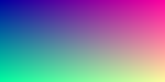
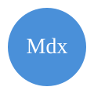

# Imágenes en la vista previa

Fixture para la verificación visual de la US-4.4.

## Relativa (PNG)

## Relativa (SVG)

## No existe

## Remota (no se carga)

## Pegar una imagen

Copie una imagen al portapapeles (por ejemplo, una captura de pantalla), coloque el cursor
aquí y pulse Ctrl/Cmd+V. Se guardará en `assets/AAAAMMDD-N.png` y se insertará el enlace:

